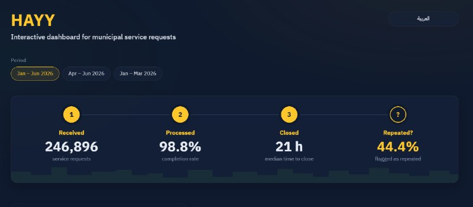
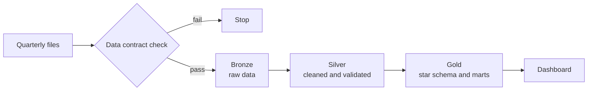
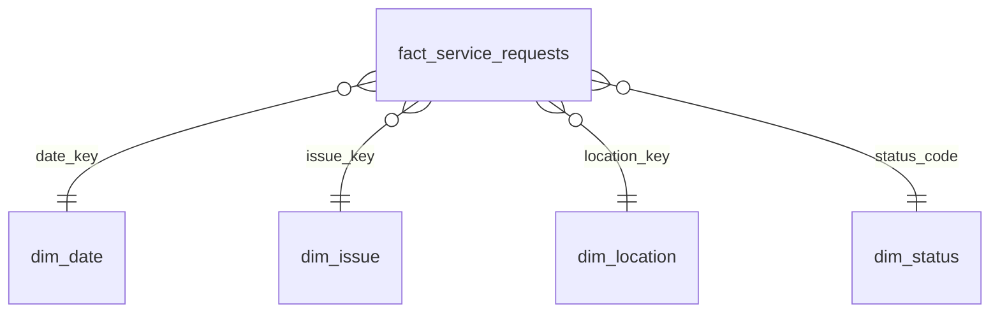

# HAYY | حيّ

An end-to-end data pipeline and a bilingual (Arabic / English) dashboard for municipal 940 service requests.

Most reports measure how fast a request is closed. HAYY also measures whether the same problem comes back after it is closed, so customer-experience teams can tell which issues need a real fix and not just a faster response.



## Tech stack

| Tool | Used for |
|---|---|
| Python, pandas | Schema validation and ingestion |
| BigQuery | Data warehouse (Bronze, Silver, Gold) |
| dbt | Transformations, data-quality tests, lineage |
| Apache Airflow | Orchestration |
| Streamlit, Plotly | Interactive dashboard |
| OpenStreetMap | Neighborhood coordinates for the map |
| pytest, Git | Testing and version control |

## Architecture



| Layer | What it holds |
|---|---|
| Bronze | The source data exactly as published, with lineage for every row (file, row number, file hash, load time) |
| Silver | One clean row per request, with data-quality flags. No record is deleted |
| Gold | Fact and dimension tables, a performance mart per request type, and a reporting table for the dashboard |

Airflow runs the whole pipeline: validation, loading, and the dbt build with all tests. If the data fails a check, nothing moves to the next layer.

## Data-quality challenges

The source data changed between releases without notice. These are the main issues the pipeline detects and handles automatically:

| Challenge | How it is handled |
|---|---|
| In the second quarter the column names stayed the same, but the content changed: "status" held closure hours and "closure time" held a time band | The layout of each row is detected from its content, not from the column name |
| The source has no request ID | A stable key built from the file fingerprint and the row number |
| Sheet names, column names and file names change in every release | A data contract with column aliases |
| The same request type is written differently across quarters (272 spellings for 245 types) | A mapping that links every variant to one standard type, in Arabic and English |
| Neighborhood names in the first quarter are cut to the first word | These records are flagged and kept out of neighborhood comparisons |

## Data model



| Table | One row per |
|---|---|
| `fact_service_requests` | Request |
| `dim_issue` | Request type, with Arabic and English labels and a service domain |
| `dim_location` | Location, with its type and map coordinates |
| `gold_issue_performance` | Quarter and request type, with closure time, repeat rate and decision group |
| `rpt_service_requests` | Request, with all labels and KPIs ready for the dashboard |

## How request types are grouped

Each request type is compared with the other types in the same quarter, by median closure time and repeat rate:

| | Low repeat | High repeat |
|---|---|---|
| **Fast** | Effective | Needs root-cause review |
| **Slow** | Operational delay | Priority |

## Testing

- dbt tests for row reconciliation between layers, referential integrity, unique keys, accepted values and translation coverage
- Unit tests for the schema validator with pytest

## Dashboard

Each language has its own page, and the Arabic page is fully right-to-left.

- **City overview:** request journey, resolution effectiveness, neighborhood map, top services, monthly trend, most repeated request types
- **Intervention priorities:** closure time against repeat rate, and the request types to review first
- **Data reliability:** coverage and quality indicators behind the figures


## Project structure

```
airflow/          orchestration
config/           data contract
src/ingestion/    validation and loading
src/enrichment/   neighborhood coordinates
dbt/balagh/       Silver and Gold models, seeds, tests
dashboard/        Streamlit app
tests/            unit tests
docs/             findings and design decisions
```

---

**Sama Alharbi** · Data Engineering
